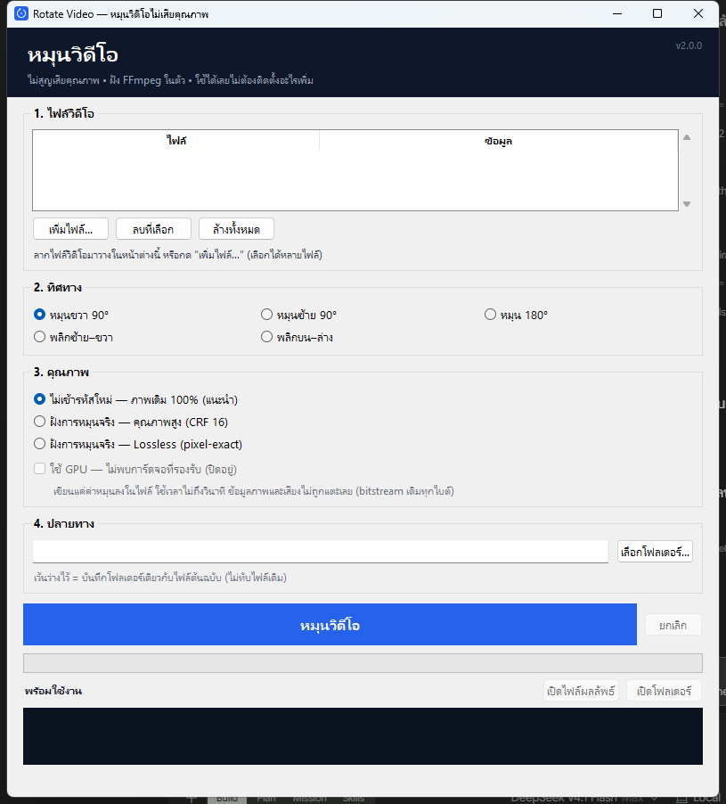

# Rotate Video — หมุนวิดีโอไม่เสียคุณภาพ

โปรแกรม Windows แบบ **ไฟล์เดียว** สำหรับหมุนวิดีโอ 90° / 180° และพลิกภาพ
**ไม่ต้องติดตั้ง FFmpeg หรืออะไรเพิ่ม** (ฝังไว้ใน exe แล้ว)

[](https://github.com/NarDecH/rotate-video/actions/workflows/build.yml)

**ดาวน์โหลด:** [GitHub Releases](https://github.com/NarDecH/rotate-video/releases) —
เลือก `RotateVideo.exe` (ไฟล์เดียว) หรือ `RotateVideo-portable.zip` (เปิดเร็วกว่า)



## ใช้งาน

1. ดับเบิลคลิก `RotateVideo.exe`
2. ลากไฟล์วิดีโอมาวางในหน้าต่าง (ได้หลายไฟล์พร้อมกัน) หรือกด **เพิ่มไฟล์…**
3. เลือกทิศทาง → เลือกคุณภาพ → กด **หมุนวิดีโอ** (หรือกด **Enter**)
4. ไฟล์ใหม่ถูกบันทึกข้างไฟล์เดิม ชื่อ `..._rot90cw.mp4` — **ไม่ทับไฟล์เก่า**
   แล้วกด "เปิดไฟล์ผลลัพธ์" / "เปิดโฟลเดอร์" ได้ทันที

พื้นที่ว่างและขนาดผลลัพธ์โดยประมาณจะแสดงก่อนเริ่ม ถ้าไม่พอโปรแกรมจะเตือน
ครั้งแรกที่เปิดจะแตก FFmpeg ไปที่ `%LOCALAPPDATA%\RotateVideo\bin\` (ราว 2–4 วินาที)

## โหมดคุณภาพ

| โหมด | ทำอะไร | คุณภาพ | ไฟล์ | ใช้เมื่อ |
|---|---|---|---|---|
| **ไม่เข้ารหัสใหม่** (ค่าเริ่มต้น) | เขียนค่าหมุน (display matrix) ด้วย `-c copy` | **bitstream เดิมทุกไบต์** | เท่าเดิม | ดูบนเครื่องเล่น/เบราว์เซอร์ปกติ ต้องการคุณภาพ 100% |
| **ฝังการหมุนจริง — CRF 16** | หมุนพิกเซลจริงแล้วเข้ารหัส H.264 ใหม่ | คมชัดสูงมาก | ใกล้เคียงเดิม | อัปโหลด/ส่งต่อให้ระบบที่ตัด metadata ทิ้ง |
| **ฝังการหมุนจริง — Lossless (QP 0)** | หมุนพิกเซลจริงแบบ lossless | **pixel-exact (PSNR = ∞)** | ใหญ่ขึ้น 3–10 เท่า | งานที่ต้องการความแม่นยำระดับ masters |

> การหมุนไม่มีการย่อ/ขยายภาพ ความละเอียดจึงไม่ลดในทุกโหมด

### ตัวเลือกเสริม

- **ใช้ GPU (NVENC / QSV / AMF)** — เฉพาะโหมด CRF, เร็วขึ้นมาก
  โปรแกรมทดสอบ GPU จริงก่อนเปิดให้ใช้ และถ้า encoder ล้มเหลวจะถอยไปใช้ CPU ให้อัตโนมัติ
- **คิวหลายไฟล์** — เลือกหลายคลิปแล้วรันต่อเนื่อง มี progress รวม + ETA ต่อไฟล์
- **จำค่าล่าสุด** (โหมด/ทิศทาง/โฟลเดอร์/GPU) ใน `%LOCALAPPDATA%\RotateVideo\settings.json`
- **ตรวจผลลัพธ์อัตโนมัติ** — อ่านขนาด/ค่าหมุนของไฟล์ที่ได้มาแสดงให้เห็น

## CLI (ใช้ในสคริปต์)

```bash
RotateVideo.exe clip.mp4 --rotate cw90 --mode copy
RotateVideo.exe *.mp4 --rotate cw90 --mode crf --out D:\rotated --gpu
```

ตัวเลือก: `--rotate cw90|ccw90|rot180|fliph|flipv`, `--mode copy|crf|lossless`,
`--out DIR`, `--gpu`, `--yes`

## คอนเทนเนอร์และไฟล์ที่รองรับ

อ่านได้: `.mp4 .m4v .mov .mkv .webm .avi .wmv .flv .ts .mts .m2ts .ogv .3gp`

- โหมดคัดลอกใช้ได้กับ `.mp4 .m4v .mov .mkv .webm`
- คอนเทนเนอร์ `.ogv` / `.wmv` / `.avi` ไม่เหมาะกับ H.264 → โหมดฝังจริงจะบันทึกเป็น **`.mp4`** ให้อัตโนมัติ
  (และแปลงเสียงเป็น AAC เมื่อปลายทางเป็น MP4)
- ไฟล์ MKV ที่มีไฟล์แนบ (ฟอนต์ซับ) จะถูกคัดลอกไปด้วย
- ภาพปก (cover art) จะไม่ถูกนับเป็นวิดีโอหลัก

## สิ่งที่ตรวจสอบอัตโนมัติ

รัน `RotateVideo.exe --selftest` แล้วดู `%TEMP%\RotateVideo-selftest.log` ตรวจว่า

- โหมดคัดลอก: md5 ของ video bitstream **เหมือนต้นฉบับทุกไบต์**
- lossless: PSNR = `inf` และขนาดภาพสลับถูกต้อง
- ไฟล์ที่มีค่าหมุนอยู่แล้วไม่ถูกหมุนซ้อน
- `.ogv` ถูกแปลงเป็น `.mp4` สำเร็จ
- ไฟล์แนบใน MKV ยังอยู่หลังเข้ารหัสใหม่
- โหมด CLI ทำงานได้จริง

## ข้อจำกัด

- โหมดไม่เข้ารหัสใหม่พึ่งค่าหมุนในไฟล์ — บางเว็บ/โปรแกรมตัดต่อตัดค่านี้ทิ้ง
- Lossless ใช้ H.264 profile *High 4:4:4 Predictive* — เครื่องเล่นเก่าบางรุ่นไม่รองรับ
- การพลิกภาพต้องเข้ารหัสใหม่เสมอ (ไม่มีโหมดคัดลอก)
- วิดีโอ HDR จะแสดงคำเตือน แต่ไม่ได้แปลง HDR→SDR ให้
- exe ยังไม่ได้ลงลายเซ็นดิจิทัล → SmartScreen อาจเตือนครั้งแรก
  (More info → Run anyway) การแจกจ่ายวงกว้างควรซื้อ code signing certificate
- Windows 10/11 64-bit

## สิทธิ์การใช้งาน

- โค้ดในโปรเจกต์นี้: MIT (ดู `LICENSE`)
- FFmpeg ที่ฝังใน exe: **GPLv3** — ถ้าแจกจ่ายให้บุคคลภายนอกต้องปฏิบัติตาม GPL
  รายละเอียดใน `THIRD-PARTY.md`

## ซอร์สโค้ดและ CI

- Repository: <https://github.com/NarDecH/rotate-video>
- GitHub Actions จะรัน self-test แล้ว build ทั้งแบบไฟล์เดียวและโฟลเดอร์ทุกครั้งที่ push
  และจะสร้าง Release อัตโนมัติเมื่อ push tag `v*`

## สำหรับนักพัฒนา

```
rotate_core.py   เอนจิน: probe / วางแผน / สร้างคำสั่ง FFmpeg / progress / ตรวจผล
app.py           GUI (Tkinter) + CLI + โหมด --selftest
tools/           สคริปต์สร้างไอคอน, ถ่ายภาพหน้าจอ, ทดสอบ GUI
build.sh         สร้าง exe (onefile) หรือโฟลเดอร์ (onedir + zip)
```

สร้างใหม่:

```bash
pip install pyinstaller windnd
bash build.sh          # dist/RotateVideo.exe (ไฟล์เดียว)
bash build.sh onedir   # dist/RotateVideo/ + RotateVideo-portable.zip (เปิดเร็วกว่า)
```

ต้องมี `imageio-ffmpeg` ในเครื่องสำหรับดึง ffmpeg มาไว้ที่ `vendor/ffmpeg.exe`
(exe ที่ได้ไม่ต้องใช้มันอีก)
